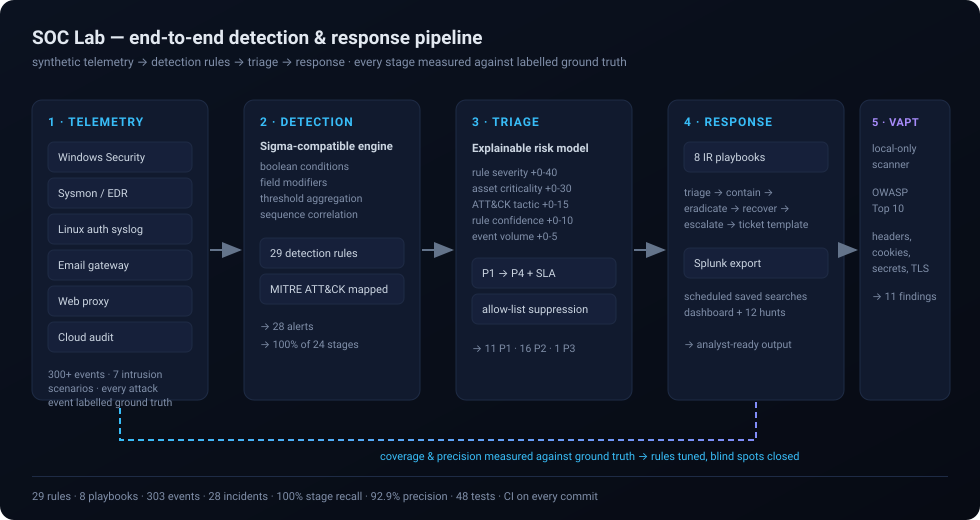

<div align="center">

# SOC Lab

**A hands-on Security Operations Centre home lab — telemetry → detection → triage → response.**

[](https://github.com/Gurukrishna0987/SOC/actions/workflows/ci.yml)


**29 detection rules · 8 response playbooks · 100% of 24 attack stages detected · 92.9% alert precision**

</div>

---

## Why this exists

I am a final-year B.E. student in Cyber Security & Blockchain, looking for a
**SOC Analyst internship from December 2026**. Every fresher SOC portfolio I
found was either a screenshot of a course dashboard, a copied
`snort`/`Suricata` rule, or a project that stopped at "here is a detection
rule" with nothing on the other side of it.

None of them showed the actual job. The job is not writing a rule. The job is:
a rule fires at 3am, an analyst has to decide whether it is real, prioritise
it against 400 other alerts, know what the asset is worth, and do something
documented enough that the next person can repeat it.

So I built the whole pipeline. This repository is a working SOC — synthetic
telemetry, a Sigma-compatible detection engine, a triage layer that scores
and explains every alert, incident-response playbooks, a live dashboard, and
a Splunk export. **And every attack event in the corpus is labelled**, which
means the rules can be *measured* instead of assumed to work.

That is the point of the whole project: **100% of 24 attack stages detected at
92.9% precision, and I can show you exactly which two alerts are false
positives and why.**

---

## The pipeline



| Stage | What happens | Output |
|---|---|---|
| **1 · Telemetry** | A deterministic generator produces Windows Security, Sysmon/EDR, Linux auth, email gateway, web proxy and cloud audit events. 7 intrusion scenarios are woven through realistic background traffic, and every attack event is labelled with ground truth. | 303 events (71 attack / 232 benign) |
| **2 · Detection** | A Sigma-compatible engine evaluates 29 rules: boolean conditions, field modifiers, threshold aggregation and cross-event sequence correlation. | 28 alerts |
| **3 · Triage** | Each alert is enriched with asset criticality, scored on a transparent 0–100 model, given a P1–P4 priority and an SLA, correlated with related alerts, and checked against the allow-list. | 11 P1 · 16 P2 · 1 P3 |
| **4 · Response** | Every rule links to one of 8 incident-response playbooks (triage → contain → eradicate → recover → escalate, plus a ticket template). Everything exports to Splunk as scheduled saved searches. | Analyst-ready output |
| **5 · VAPT** | A deliberately **local-only** web scanner finds misconfigurations, insecure cookies, exposed secrets, directory listing and TLS problems — mapped to OWASP Top 10 2021. | 11 findings |

---

## Quickstart

```bash
git clone https://github.com/Gurukrishna0987/SOC.git
cd SOC

python3 -m venv .venv
.venv/bin/pip install -r requirements.txt

.venv/bin/python -m soclab demo      # run the whole pipeline
.venv/bin/python -m soclab evaluate  # detection coverage + precision
.venv/bin/python -m soclab serve     # dashboard on http://localhost:8080
```

Or with `make`:

```bash
make setup && make demo && make test && make serve
```

The demo prints the whole story in about a second:

```
====================================================================
SOC LAB - END TO END DEMO
====================================================================
Telemetry generated : 303 events (71 attack / 232 benign)
Rules evaluated     : 29
Alerts raised       : 28
Incidents triaged   : 28  {'P1': 11, 'P2': 16, 'P3': 1}
Attack-stage recall : 100.0%
Alert precision     : 92.9%
--------------------------------------------------------------------
TOP PRIORITY INCIDENTS
  P1   97.0  SOC-002  DC01          Successful logon from a source that had recent failed logons
  P1   89.0  SOC-008  WKS-FIN-014   PowerShell script block contains a download cradle
  P1   89.0  SOC-009  WKS-FIN-014   Antivirus real-time protection disabled
  P1   89.0  SOC-025  SRV-FS-002    Mass file encryption - files renamed with a ransomware extension
====================================================================
```

---

## The dashboard

`python -m soclab serve` gives you a live SOC console — no build step, no
external assets, no CDN, works offline.

| Page | What it shows |
|---|---|
| **Overview** | KPIs, alert volume per day, top firing rules, most-affected assets, ATT&CK tactic and technique distribution, priority incident list |
| **Incidents** | The full queue with filters for priority, status and rule; free-text search across title, asset, user, IP and technique |
| **Incident detail** | The risk breakdown with every scoring component spelled out, enriched entities, the raw matched events, the linked playbook and the rule's SPL |
| **Hunt** | Free-text hunting across every field of every event — the "no alert fired" side of the job |
| **Coverage** | The attack matrix (every stage of every scenario, detected or missed), MITRE technique coverage and per-rule precision |
| **Playbooks** | All 8 response playbooks with containment commands, escalation triggers and ticket templates |

<details>
<summary>Preview the JSON API</summary>

```bash
curl -s localhost:8080/api/summary        # pipeline metrics
curl -s localhost:8080/api/incidents      # every triaged incident
curl -s localhost:8080/api/incidents/INC-0001
curl -s localhost:8080/api/evaluation     # coverage + precision
curl -s localhost:8080/api/rules          # all 29 rules
curl -s localhost:8080/api/events?limit=50
```
</details>

---

## Detection rules

29 rules in a **Sigma-inspired YAML format** — vendor-neutral, reviewable by
peers, and convertible to Splunk SPL, Elastic, Sentinel or Chronicle. This is
the same format used by production SOCs, not a home-grown one.

```yaml
- id: SOC-002
  title: Successful logon from a source that had recent failed logons
  description: >-
    A successful Windows logon (4624) from a source IP that produced failed
    logons in the previous 15 minutes. This is the "the brute force worked"
    moment and is the highest-value detection for a Tier-1 analyst.
  severity: critical
  confidence: high
  mitre:
    tactic: Credential Access
    technique: T1110
    subtechnique: T1110.001
  detection:
    failures:
      event.code: 4625
    success:
      event.code: 4624
      event.outcome: success
    condition: sequence
    sequence: [failures, success]
    sequence_threshold: 3
    group_by: [source.ip]
    window: 15m
  fields: [source.ip, user.name, host.name]
  falsepositives:
    - A user correcting a typo immediately after
  playbook: PB-001
  splunk:
    spl: >-
      index=* EventCode=4625 | stats count as fails dc(user) as user by src_ip
      | where fails > 3 | join src_ip [ search index=* EventCode=4624 | table
      _time src_ip user Account_Name ]
```

**What the engine supports:** `selection` / `filter` clauses, `and` / `or` /
`not`, `all of them` / `1 of selection_*`, wildcards, `contains` /
`startswith` / `endswith` / `re`, numeric comparison (`">0"`, `">=5"`),
threshold aggregation over a time window (`| count() > 10`) and sequence
correlation (`sequence: [failures, success]`).

**Coverage by scenario:**

| Scenario | Stages | Detected by |
|---|---|---|
| Credential brute force / password spray | 4 | SOC-001, SOC-002, SOC-006 |
| Phishing → credential theft | 4 | SOC-015, SOC-016, SOC-017, SOC-028, SOC-020 |
| PowerShell obfuscation + defence evasion | 4 | SOC-007, SOC-008, SOC-009, SOC-014, SOC-026 |
| Lateral movement + privilege escalation | 5 | SOC-027, SOC-011, SOC-010, SOC-003, SOC-004 |
| Ransomware staging + exfiltration | 3 | SOC-024, SOC-025, SOC-019, SOC-020 |
| Cloud misconfiguration | 3 | SOC-021, SOC-022, SOC-023 |
| DNS tunnelling | 1 | SOC-018, SOC-020 |

---

## Splunk

Your target stack, fully supported:

```bash
python -m soclab splunk
```

Generates, in `splunk/`:

| File | What it is |
|---|---|
| `savedsearches.conf` | All 29 rules as scheduled Splunk saved searches, with severity, ATT&CK technique and playbook metadata — drop it into `$SPLUNK_HOME/etc/apps/soc_lab/local/` |
| `dashboard_soc_lab.xml` | A Splunk dashboard you can import directly |
| `hunting_queries.md` | 12 ready-to-run SPL hunting queries (impossible travel, password spray, admin share access, DNS tunnelling, large exfiltration…) |
| `README.md` | Step-by-step instructions for the 30-day Splunk Enterprise trial |

The export also contains the **ECS → Splunk CIM field mapping** table — the
translation every SOC engineer has to do, and one that is invisible until it
breaks in production.

---

## VAPT (local-only by design)

```bash
python lab/insecure_demo/app.py                 # vulnerable app on 127.0.0.1:5001
python -m soclab vapt http://127.0.0.1:5001    # scan it
```

The scanner checks missing security headers, cookie flags (`Secure` /
`HttpOnly` / `SameSite`), plain HTTP, verbose debug output, directory
listing, exposed sensitive files (`.env`, `.git/HEAD`, backups), server
version disclosure and TLS configuration. Every finding carries an OWASP
Top 10 2021 mapping, the evidence and a concrete fix, and is written out as a
Markdown or JSON report.

> **Safety:** the scanner **refuses to scan anything that is not a loopback
> address** unless you explicitly pass `--allow-remote` for a host you are
> authorised to test. It performs no exploitation, no injection and no
> denial-of-service. This is a portfolio and learning tool, not a scanner to
> point at someone else's network.

---

## Repository layout

```
SOC/
├── soclab/                 # the pipeline
│   ├── schema.py           # ECS-style canonical field schema
│   ├── events.py           # Event model + JSONL (de)serialisation
│   ├── generator.py        # synthetic telemetry + labelled attack corpus
│   ├── rules.py            # Sigma-style rule loader
│   ├── engine.py           # detection engine (conditions, aggregation, sequences)
│   ├── triage.py           # enrichment, risk scoring, prioritisation, correlation
│   ├── eval.py             # coverage + precision measurement
│   ├── playbooks.py        # response playbook loader
│   ├── splunk.py           # SPL generation + saved searches + dashboard export
│   ├── vapt.py             # local-only web assessment scanner
│   ├── dashboard.py        # Flask SOC console
│   ├── pipeline.py         # orchestration
│   └── cli.py              # `python -m soclab <command>`
├── rules/                  # 29 detection rules (Sigma format)
├── playbooks/              # 8 incident-response playbooks
├── config/                 # asset inventory, org context, allow-lists
├── splunk/                 # generated Splunk assets
├── lab/insecure_demo/      # intentionally vulnerable reference app
├── tests/                  # 48 pytest tests
├── docs/                   # the career kit (see below)
└── .github/workflows/      # CI: tests + pipeline + export validation
```

### CLI

| Command | What it does |
|---|---|
| `python -m soclab demo` | Run the whole pipeline and write the artefacts |
| `python -m soclab generate` | Write the labelled corpus to `data/events.jsonl` |
| `python -m soclab detect` | Run detection and write `data/alerts.json` |
| `python -m soclab triage` | Triage alerts into prioritised incidents |
| `python -m soclab evaluate` | Print the coverage and precision report |
| `python -m soclab hunt "<query>"` | Free-text hunt across every field |
| `python -m soclab splunk` | Regenerate the Splunk assets |
| `python -m soclab vapt <url>` | Run a local-only web assessment |
| `python -m soclab serve` | Launch the dashboard |

---

### Measured results

The full output — every attack stage, per-rule precision, triage distribution
and the VAPT findings — is committed in **[docs/RESULTS.md](docs/RESULTS.md)**,
so a reviewer can see the numbers without running anything. Reproduce it with
`python -m soclab evaluate`.

---

## What I learned building this

These are the real lessons, and they are what I talk about in interviews.

**1. A rule you have not measured is a guess.** I wrote 29 rules and felt
good about them. The coverage harness then showed me a rule silently matching
nothing, because my condition parser was dropping custom clause names. The
rule looked perfect in the YAML. It had never fired. Measuring is the only
thing that distinguishes a detection from a decoration.

**2. Off-by-ones in thresholds are silent killers.** `count() > 10` means
eleven, not ten. My threshold rule was firing one event early and I did not
notice until I wrote a test for it. In a real SOC that is the difference
between an alert that helps and an alert that is trusted and wrong.

**3. A 4624 records the machine that *received* the logon, not the source.**
My lateral-movement rule matched on the source host and was therefore blind
to exactly the movement it was written to catch. Log semantics are not
optional knowledge.

**4. False positives are a design problem, not a nuisance.** The two
false-positive alerts in my corpus are users typing the wrong password three
times and then succeeding — the same signal, different intent. The fix is
not to weaken the rule; it is to correlate the *actor* (same source IP) and
to maintain an allow-list of shared egress addresses. A SOC without
suppression is a SOC that burns out.

**5. Detection without response is a dashboard.** Writing the 8 playbooks
changed how I write the rules. Once I had to say "what does the analyst do
at 3am", some rules stopped making sense — if the containment step needs a
privilege the SOC does not have, the rule is not actionable no matter how
good it is.

**6. Field naming is a real translation problem.** ECS-style names
(`host.name`, `source.ip`) to Splunk CIM names (`host`, `src_ip`) is a
mechanical mapping that becomes intuitive only after you have been burned by
it once. Now I write rules in the standard and export, instead of writing
vendor-specific queries that nobody else can use.

**7. Correlation turns 40 alerts into 1 incident.** The single most valuable
rule I wrote is "failures followed by a success from the same source". It is
a sequence, not a single-event match — and it is the difference between
forty L3 alerts and one P1 with a clear story.

---

## How to talk about this in an interview

Use these three stories; they are the strongest cards in the deck.

- **"I measured my detection coverage instead of assuming it."**
  100% of 24 attack stages across 7 intrusion scenarios, 92.9% precision,
  and I can name the two false positives and how I suppress them. *(Q: How
  do you know your coverage is good?)*

- **"I found a bug in my own detection engine using coverage metrics."**
  A custom clause name was being dropped by the condition parser, so a rule
  with `selection and suspicious_path` never fired. The YAML looked perfect.
  The measurement found it. *(Q: Tell me about a hard bug.)*

- **"I wrote the response, not just the detection."**
  Every rule links to a playbook with containment commands, escalation
  triggers and a ticket template — because the job is not raising an alert,
  it is closing an incident. *(Q: Walk me through your project.)*

Full question bank with model answers: **[docs/INTERVIEW_QA.md](docs/INTERVIEW_QA.md)**.

---

## The career kit in `docs/`

This repository is as much a job-search toolkit as it is a lab. Start here:

| File | What it gives you |
|---|---|
| **[docs/ROADMAP.md](docs/ROADMAP.md)** | The week-by-week plan from 7th semester → internship → pre-placement offer, with market data, salary bands and the traps to avoid |
| **[docs/RESUME.md](docs/RESUME.md)** | A one-page fresher resume in two versions (SOC / VAPT), ATS rules, and where every number on it comes from |
| **[docs/LINKEDIN.md](docs/LINKEDIN.md)** | Headline, About, Featured, skills, and four ready-to-post templates that get recruiters to reply |
| **[docs/INTERVIEW_QA.md](docs/INTERVIEW_QA.md)** | 44 questions with model answers: SOC fundamentals, Windows event IDs, cloud, detection engineering, VAPT, behavioural |
| **[docs/COMPANY_TARGETS.md](docs/COMPANY_TARGETS.md)** | Who to apply to in tiers (IT services → security SMEs → GCCs → government), where the postings are, and the questions that expose a bad internship |
| **[docs/INTERNSHIP_PITCH.md](docs/INTERNSHIP_PITCH.md)** | Cold emails, LinkedIn messages, referral asks and a one-page internship proposal that get replies |
| **[docs/APPLICATION_TRACKER.md](docs/APPLICATION_TRACKER.md)** | The funnel tracker, the weekly review, and the benchmarks that tell you if your search is working |
| **[docs/HUNTING_NOTES.md](docs/HUNTING_NOTES.md)** | Ten hunts to run in your first week, the daily SOC rhythm, and the six questions to ask about every alert |
| **[docs/PROFILE_README.md](docs/PROFILE_README.md)** | Your GitHub profile README, copy-paste ready |

---

## Testing

```bash
.venv/bin/python -m pytest tests/ -q
```

48 tests covering the condition engine (including the regressions I found),
window and threshold semantics, sequence correlation, the end-to-end pipeline,
attack-stage coverage, triage scoring and suppression, the Splunk export, and
the VAPT safety guard. CI runs the tests, the full pipeline, the evaluation
report and the Splunk export on every push.

---

## Safety and legality

- **All telemetry is synthetic.** Hostnames, users, IPs and events are
  fabricated. The external IPs use RFC 5737 documentation ranges
  (`198.51.100.0/24`, `203.0.113.0/24`, `192.0.2.0/24`), which are
  permanently reserved for documentation and can never resolve to a real host.
- **The VAPT scanner is loopback-only by default** and refuses remote targets
  unless explicitly overridden. It performs no exploitation.
- **`lab/insecure_demo` is intentionally vulnerable.** It binds to
  `127.0.0.1`, is for practising findings and fixes, and must never be
  deployed.
- Only ever test systems you own or have written authorisation to test.

---

## Roadmap

- [x] Synthetic corpus with labelled ground truth
- [x] Sigma-compatible detection engine (conditions, modifiers, aggregation, sequences)
- [x] 29 detection rules mapped to MITRE ATT&CK
- [x] Triage engine with an explainable risk model, SLAs and allow-list suppression
- [x] 8 incident-response playbooks with containment and escalation
- [x] Live dashboard (overview, incident queue, hunt console, coverage matrix)
- [x] Splunk export: saved searches, dashboard, 12 hunting queries
- [x] Local-only VAPT scanner + intentionally vulnerable reference app
- [x] 48 tests + CI
- [ ] Run the same rule set in a real Splunk instance and compare the results
- [ ] SOAR-style automated playbooks
- [ ] Second corpus with benign variations, to measure behaviour under noise
- [ ] Email analysis module (header parsing, SPF/DKIM/DMARC scoring)
- [ ] Publish the rules as a Sigma contribution others can use

---

## License

MIT — see [LICENSE](LICENSE).

The code, rules, playbooks and documentation are mine and free to reuse.
MITRE ATT&CK® is a registered trademark of The MITRE Corporation; the
technique IDs used here are for educational reference under their
[public-use terms](https://attack.mitre.org/resources/terms-of-use/).

## Acknowledgements

MITRE for ATT&CK and the Sigma specification; the Sigma community for the
rule format; Splunk for the free trial that makes this testable; and every SOC
analyst who has published a good write-up — especially the people whose
public detection write-ups taught me how this job is actually done.
